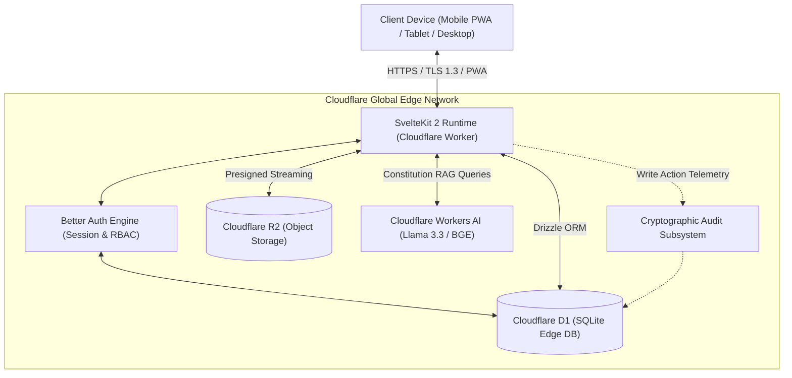
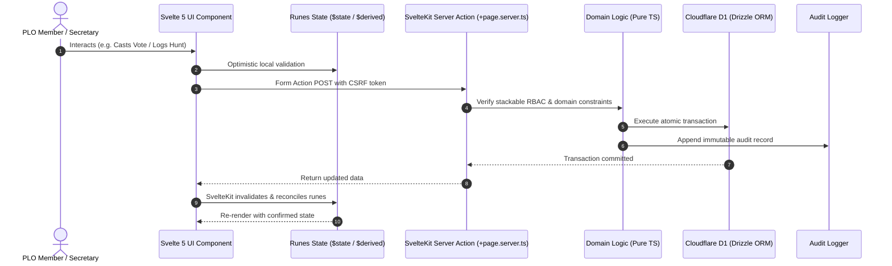
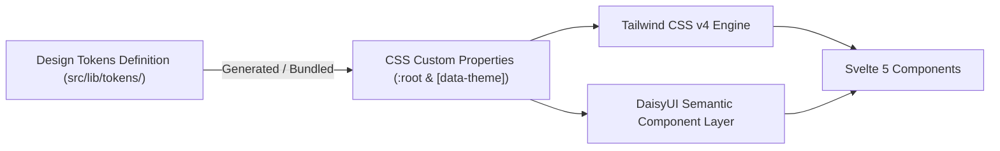
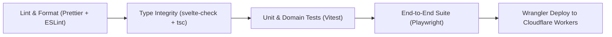

# Enterprise System Architecture & Engineering Specification
**Document ID:** `ACNR-ARCH-SPEC-2026.1`  
**Classification:** Enterprise Engineering Standard & System Architecture Blueprint  
**Target Platform:** Cloudflare Global Edge Runtime (Workers, D1 SQLite, R2 Object Storage, Workers AI)  
**Reference Application:** **ACNRPLO** (Atherstone Collaborative Nature Reserve — Private Land Owners Platform)  
**Author:** Principal Systems Architect & Enterprise Solutions Specialist  
**Date:** 18 September 2026  

---

# Part 1: Compliance & Engineering Standards

## 1. Regulatory, Statutory & Governance Compliance Standards

Because **ACNRPLO** governs legally binding land ownership percentages, constitutional voting powers, state-regulated game quotas (LEDET), and private reserve financial accounts, the system must strictly comply with the following statutory, environmental, and international frameworks:

```
┌────────────────────────────────────────────────────────────────────────────────────────┐
│                        REGULATORY & GOVERNANCE COMPLIANCE MATRIX                       │
├──────────────────────────┬─────────────────────────────┬───────────────────────────────┤
│ Standard / Regulation    │ Mandated Scope              │ System Implementation Target  │
├──────────────────────────┼─────────────────────────────┼───────────────────────────────┤
│ POPIA (Act 4 of 2013)    │ Protection of Personal      │ - Role-scoped access control  │
│ & Statutory Privacy      │ Information of Landowners   │ - Encrypted data at rest      │
│                          │                             │ - Strict tenant boundaries    │
├──────────────────────────┼─────────────────────────────┼───────────────────────────────┤
│ NEMPAA (Act 57 of 2003)  │ National Environmental      │ - Immutable game counts       │
│ & LEMA (Act 7 of 2003)   │ Management: Protected Areas │ - LEDET quota isolation       │
│                          │ & Limpopo Wildlife Norms    │ - Audited hunting off-take    │
├──────────────────────────┼─────────────────────────────┼───────────────────────────────┤
│ ACNR Constitution &      │ Legal Landowner Governance, │ - Basis-point voting engine   │
│ Shareholder Agreements   │ Voting Quorums & Resolutions│ - Cryptographic audit trail   │
│                          │                             │ - Tamper-proof poll closure   │
├──────────────────────────┼─────────────────────────────┼───────────────────────────────┤
│ ISO/IEC 27001:2022       │ Information Security        │ - Cloudflare Zero Trust edge  │
│ Controls A.8 & A.10      │ Management Systems (ISMS)   │ - Strict TLS 1.3 in transit   │
│                          │                             │ - AES-256-GCM at rest         │
├──────────────────────────┼─────────────────────────────┼───────────────────────────────┤
│ ISO/IEC 25010:2023       │ Systems & Software Quality  │ - Formal quality metrics      │
│ Quality Models (SQuaRE)  │ Requirements & Attributes   │ - Sub-2s page loads on 3G/4G  │
│                          │                             │ - 99.9% availability SLA      │
├──────────────────────────┼─────────────────────────────┼───────────────────────────────┤
│ WCAG 2.1 Level AA        │ Web Accessibility &         │ - >= 48x48px touch targets    │
│ Standard                 │ High-Glare Inclusivity      │ - 4.5:1 minimum text contrast │
│                          │                             │ - Full keyboard accessibility │
└──────────────────────────┴─────────────────────────────┴───────────────────────────────┘
```

### 1.1 Environmental & Reserve Governance Protocols (NEMPAA & LEMA)
1. **Immutable Hunting & Quota Off-Take Records:**
   All off-take logs recorded against LEDET and collective PLO quotas must be cryptographically non-repudiable. Once a hunt record is approved or committed by a member, it cannot be modified or deleted without an audited reversing entry.
2. **Quota Category Boundary Isolation:**
   LEDET reserve-level quotas and PLO commercial quotas (Hunting vs. Game Capture/Selling) are logically and relationally segregated. Transmuting quota between LEDET and private allocations is strictly prohibited by software rules.
3. **Statutory Game Census Integrity:**
   Game count census entries entered by the Secretary require the recording of observer identity, GPS/sector bounds, species enumeration, and timestamp to satisfy provincial conservation audit criteria.

### 1.2 Mathematical Rigor: Basis-Point Allocation Engine
To prevent rounding errors and floating-point drift across legal ownership percentages and voting weights:
1. **Basis Point Representation ($\text{bps}$):**
   All land portion percentages and voting weights are stored and computed as integer basis points:
   $$100.00\% = 10,000\text{ bps}, \quad 14.25\% = 1,425\text{ bps}$$
2. **Reserve Sum Invariant:**
   $$\sum_{i=1}^{N} \text{portion\_bps}_i \equiv 10,000\text{ bps}$$
   The system prevents committing any land portion record edits that violate this reserve sum invariant.
3. **Integer-Cent Monetary Mathematics:**
   All South African Rand (ZAR) prices for quota trades and game sales are stored as integer cents:
   $$\text{Price} = R\, 3,500.00 \implies 350,000\text{ cents}$$
   Floating-point currency math is strictly forbidden across both frontend and backend.

---

## 2. Accessibility Engine Standards (WCAG 2.1 Level AA)

The application is engineered for outdoor field conditions (high African sun, open vehicle operation, and dust-resistant glove usage):

* **High-Glare Visual Contrast (SC 1.4.3):**
  - Minimum contrast ratio of **4.5:1** for standard body text (`16px`) against background canvas in both light and dark modes.
  - Minimum contrast ratio of **3.0:1** for graphical elements, progress tracks, and interactive borders.
* **Field-Grade Touch Ergonomics (SC 2.5.5):**
  - All interactive buttons, segmented voting choices, and list items enforce a minimum bounding box of **$48 \times 48\text{ CSS px}$** with at least **$8\text{ px}$** separation.
* **Multi-Sensory Status Indication (SC 1.4.1):**
  - Quota status, voting outcomes, and poll progress are never communicated by color alone. Every badge is paired with an icon and explicit text label.
* **Assistive Technology & Live Status Announcements (SC 4.1.3):**
  - Cloudflare AI streaming text output must communicate via an `aria-live="polite"` landmark to ensure screen-reader accessibility during inference.

---

## 3. Performance Service Level Agreements (SLAs) & Quality Attributes

| Attribute | Architectural Metric | Strict SLA Target | Measurement / Audit Protocol |
| :--- | :--- | :--- | :--- |
| **Edge TTFB** | Time to First Byte (SSR) | $\le 150\text{ ms}$ (95th percentile) | Cloudflare Edge Analytics / Global PoP probe |
| **AI Inference Latency**| Constitution RAG response | $\le 2500\text{ ms}$ (Time to first token $\le 600\text{ ms}$) | Cloudflare Workers AI telemetry |
| **Largest Contentful Paint**| Core Web Vital (LCP) | $\le 1.8\text{ s}$ under 4G network | Lighthouse / Chrome User Experience Report |
| **Interaction to Next Paint**| Input responsiveness (INP)| $\le 100\text{ ms}$ | Real User Monitoring (RUM) metrics |
| **Cumulative Layout Shift**| Visual stability (CLS) | $\le 0.05$ | Playwright visual regression testing |
| **Client Bundle Budget**| Initial JS payload | $\le 90\text{ kB}$ (Brotli/Gzipped) | Vite build budget check in CI pipeline |
| **System Availability** | Edge application uptime | $99.9\%$ availability | Cloudflare Edge SLA & synthetic monitors |

---

## 4. Architectural Patterns & Modularity Standards

1. **Hexagonal Architecture (Ports & Adapters):**
   - Core domain business logic (vote weight resolution, quota balance calculations, role validation) is isolated in pure TypeScript modules with zero runtime dependency on Cloudflare bindings (`platform.env`).
   - Storage (R2), Database (D1), AI (Workers AI), and Authentication (Better Auth) are integrated strictly through interface contracts (Ports).
2. **Svelte 5 Runes Architecture:**
   - All client and shared reactive state is built on Svelte 5 runes: `$state()`, `$derived()`, `$derived.by()`, `$effect()`, and `$props()`.
   - Legacy Svelte 3/4 stores (`writable`, `derived`) and reactive declarations (`$:`) are disallowed.
3. **Stackable Role-Based Access Control (RBAC):**
   - User roles are modeled as a bitmask / stackable set (`Secretary`, `Executive`, `Main PLO`, `Associate`).
   - Permissions are additive: a user assigned both `Secretary` and `Main PLO` receives the full union of capabilities.

---

# Part 2: System Architecture Specification

## 1. Architectural Overview & System Goals

The **ACNRPLO** platform is an edge-native, mobile-first Progressive Web Application designed to deliver high availability, low-latency performance, and legally defensible transparency for the co-owners of the Atherstone Nature Reserve.



### Primary Architectural Goals:
- **Zero-Trust Edge Execution:** Low-latency server-side rendering (SSR) and API handling executed within milliseconds of users across South Africa.
- **Single Source of Truth:** Centralized database for land parcels, quotas, votes, and census data, eliminating divergent WhatsApp chats.
- **Constitutional AI Guardrails:** Cloudflare Workers AI strictly bound to the reserve constitution via RAG embeddings, preventing hallucinations.
- **Progressive Web App Offline Resilience:** Installable application package with local asset caching for field reliability.

---

## 2. Component & System Hierarchy (Core Architecture)

The codebase is organized into four clean architectural tiers:

```
src/
├── lib/
│   ├── server/                     # Domain & Infrastructure (Server-Only)
│   │   ├── db/                     # D1 Database & Drizzle ORM
│   │   │   ├── schema/             # Entity schemas (users, portions, quotas, polls)
│   │   │   ├── migrations/         # D1 SQL migrations
│   │   │   └── client.ts           # D1 client instantiation
│   │   ├── auth/                   # Better Auth configuration & RBAC guards
│   │   ├── ai/                     # Cloudflare AI Constitution RAG pipeline
│   │   ├── storage/                # Cloudflare R2 bucket integration
│   │   └── audit/                  # Audit log recording subsystem
│   ├── domain/                     # Pure Business Logic (Framework-Agnostic)
│   │   ├── allocation/             # Basis-point math & quota engines
│   │   ├── voting/                 # Weighted voting quorum & result calculators
│   │   └── calendar/               # Visit conflict & capacity validation
│   ├── components/                 # Presentation Tier (Svelte 5 Runes)
│   │   ├── ui/                     # Atoms & Design System components
│   │   ├── governance/             # Vote cards, poll creators, weight banners
│   │   ├── quota/                  # Quota ledgers, hunt loggers, trade sheets
│   │   ├── calendar/               # Visit booking cards, agenda grids
│   │   └── ai/                     # Constitution chat widget, citation drawers
│   └── tokens/                     # Design Tokens & Theme Definitions
│       ├── colors.ts
│       ├── typography.ts
│       └── spacing.ts
└── routes/                         # SvelteKit Routing & Endpoints
    ├── (auth)/login                # Better Auth credential forms
    ├── (app)/                      # Authenticated Application Layout
    │   ├── dashboard               # Unified reserve metric landing
    │   ├── governance              # Voting polls, land portions, audit trail
    │   ├── quota                   # LEDET & PLO quota ledgers, hunt logs
    │   ├── calendar                # Shared visit schedule
    │   ├── documents               # R2 repository & Constitution viewer
    │   ├── finance                 # Executive financial ledgers
    │   └── ai                      # Fullscreen Constitution Assistant
    └── api/                        # Edge RPC endpoints & AI streaming routes
```

---

## 3. Component State Lifecycle & Management Model

State management follows a unidirectional data flow powered by Svelte 5 Runes:



### State Management Guidelines:
1. **Server-Owned Truth:** All authoritative data is loaded via `+page.server.ts` and passed through page props.
2. **Local Component State (`$state()`):** Used strictly for ephemeral UI state (e.g., open dropdowns, active tabs, modal visibility).
3. **Derived Computations (`$derived()`):** All quota balances, remaining capacities, and voting tallies are computed via pure derived functions to prevent state synchronization desynchronization.
4. **No Global Singletons:** Client-side global mutable singletons are prohibited; page-level state is propagated via Svelte's `setContext` / `getContext` APIs using typed rune wrappers.

---

## 4. Tokens & Configuration Infrastructure (Data Flow & Pipeline)

Design tokens are managed as the single source of truth for the styling pipeline, compiled into CSS Custom Properties and consumed by Tailwind CSS v4 and DaisyUI:



### Token Invariants:
- **Strict Prefixing:** Custom properties are scoped with `--color-*`, `--font-*`, `--space-*`, and `--elevation-*`.
- **Runtime Theme Switching:** Light and dark modes are toggled via the `data-theme` attribute on `<html>`, with instant CSS custom property switching and zero page reload.

---

## 5. Cross-Cutting Concerns

### 5.1 Security Architecture & Authentication
- **Better Auth Integration:** Handled via Cloudflare D1 SQLite adapter using secure session cookies (`HttpOnly`, `SameSite=Lax`, `Secure`).
- **Stackable Role Gates:** Server actions enforce strict bitmask/array checks:
  ```typescript
  export function requireRole(user: SessionUser, allowedRoles: UserRole[]) {
    const hasPermission = user.roles.some((role) => allowedRoles.includes(role));
    if (!hasPermission) {
      throw error(403, { message: 'Insufficient role permissions' });
    }
  }
  ```
- **Self-Registration Lock:** Public signup routes are disabled at the engine level. Only accounts initiated by a verified `Secretary` session are created.
- **CSRF & Origin Protection:** All mutation endpoints validate SvelteKit origin headers and CSRF tokens automatically.

### 5.2 Constitution AI RAG Pipeline
- **Vector Ingestion:** The PLO Constitution document is chunked (500 tokens with 50-token overlap) and embedded via Cloudflare Workers AI (`@cf/baai/bge-base-en-v1.5`).
- **Edge Retrieval & Inference:** Queries fetch the top-3 most relevant clauses and inject them into a locked prompt template executed on `@cf/meta/llama-3.3-70b-instruct`:
  ```
  SYSTEM: You are the legal assistant for the Atherstone Nature Reserve PLO.
  You must answer questions SOLELY based on the provided Constitution excerpts.
  If the answer cannot be determined from the excerpts, state that explicitly.
  Always cite the specific Article and Clause number.
  ```

### 5.3 Performance & Caching Strategy
- **Static Assets & PWA Shell:** Cached at Cloudflare edge PoPs with `Cache-Control: public, max-age=31536000, immutable`.
- **Dynamic Data Invalidation:** SvelteKit `invalidateAll()` or targeted `invalidate('app:quota')` triggers surgical re-fetching of modified database entities.
- **R2 Document Streaming:** Large documents and PDFs are served through Workers streaming responses with range request support (`Accept-Ranges: bytes`).

---

## 6. Developer Experience (DX), CI/CD & Versioning Pipeline

### 6.1 Development Workflow
- **Package Manager:** `pnpm` exclusively (enforced via `only-allow pnpm`).
- **Local Edge Emulation:** Local development runs inside Miniflare / Wrangler to emulate D1, R2, and Workers AI faithfully without cloud latency:
  ```bash
  pnpm dev          # Launches Vite + Wrangler local edge simulation
  pnpm db:generate  # Generates Drizzle migration files from TS schema
  pnpm db:migrate   # Applies D1 migrations to local SQLite
  ```

### 6.2 CI/CD Automation Matrix (GitHub Actions)
Every pull request and merge to `main` executes the automated verification pipeline:



### 6.3 Semantic Versioning & Database Migration Discipline
1. **Database Schema Versioning:**
   - D1 migrations must be strictly additive. Dropping columns or destructive table rewrites are prohibited in production without a two-phase rollout.
   - All migrations are tracked in `src/lib/server/db/migrations/` and committed to git.
2. **Release Tagging:**
   - Follows Semantic Versioning (`MAJOR.MINOR.PATCH`).
   - Breaking governance workflows or constitutional calculation adjustments trigger a `MAJOR` increment.
