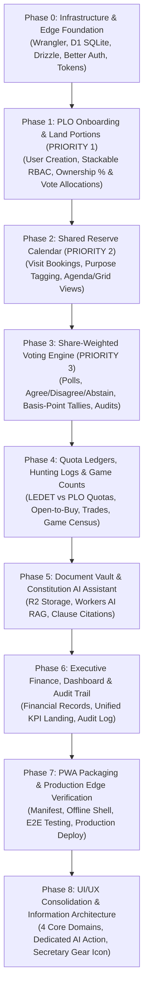

# ACNRPLO — Phased Implementation Plan & Execution Tracker
### Atherstone Collaborative Nature Reserve — Private Land Owners Platform

**Document ID:** `ACNR-IMPL-2026.1`  
**Status:** `Completed & Production Edge Verified`  
**Target Platform:** Cloudflare Workers, D1 SQLite, R2 Storage, Workers AI, SvelteKit 2 (Svelte 5 Runes)  
**Primary Immediate Priorities:**
1. **PLO Onboarding & Land Portion Management** (User accounts, stackable roles, ownership percentages, vote weights)
2. **Shared Reserve Calendar** (Visit bookings, purpose tagging, conflict detection, all-member visibility)
3. **Share-Weighted Voting Engine** (Pre-loaded polls, basis-point weighted Agree/Disagree/Abstain votes, audit trails)

---

## Phased Implementation Roadmap

---

## Phase 0: Infrastructure & Edge Foundation

> **Objective:** Establish the Cloudflare serverless edge bindings, D1 SQLite database connection with Drizzle ORM, Better Auth authentication foundation, and Svelte 5 design token integration.

### Checklist:
- [x] **0.1 Cloudflare Bindings Setup (`wrangler.jsonc`)**
  - [x] Configure Worker name `acnrploapp` with node compatibility flags.
  - [x] Configure Cloudflare D1 database binding (`DB`).
  - [x] Configure Cloudflare R2 bucket binding (`BUCKET`).
  - [x] Configure Cloudflare Workers AI binding (`AI`).
- [x] **0.2 Database Layer Setup (D1 + Drizzle ORM)**
  - [x] Install and configure `drizzle-orm` and `drizzle-kit`.
  - [x] Create `drizzle.config.ts` targeting D1 SQLite schema.
  - [x] Initialize typed database client in `src/lib/server/db/index.ts`.
  - [x] Generate and execute initial D1 migrations (`0000_certain_lockjaw.sql`).
- [x] **0.3 Authentication Foundation (Better Auth)**
  - [x] Configure Better Auth with SQLite/D1 adapter.
  - [x] Define user, session, account, and verification tables in Drizzle.
  - [x] Implement credential login (username & password).
  - [x] Enforce `selfRegistration: false` (only Secretary can create accounts).
- [x] **0.4 Design Tokens & Layout Shell**
  - [x] Configure Tailwind CSS v4 & DaisyUI themes (`acnr-light`, `acnr-dark`).
  - [x] Integrate custom design tokens (`--color-primary`, `--font-mono`, etc.) into `src/app.css`.
  - [x] Build base layout (`src/routes/+layout.svelte`) with responsive navigation, role badges, and theme toggle.

---

## Phase 1: PLO Onboarding & Land Portions (Priority 1)

> **Objective:** Deliver a complete, secure onboarding pipeline for all reserve landowners. The Secretary can create member accounts, assign stackable roles, configure land portion sizes and ownership percentages, and establish the mathematical basis for voting allocations.

### Checklist:
- [x] **1.1 User & Role Database Schema**
  - [x] Define `users` schema with stackable roles array (`secretary`, `executive`, `main_plo`, `associate`).
  - [x] Define `associates` linking table (Associate Member $\to$ Sponsoring Main PLO Member).
  - [x] Enforce cascade deactivation: deactivating a Main PLO Member disables linked Associates.
- [x] **1.2 Land Portion Schema & Mathematical Validation**
  - [x] Define `land_portions` schema: `id`, `user_id`, `portion_name`, `hectares`, `ownership_bps` (basis points: $100.00\% = 10,000\text{ bps}$), `vote_allocation_bps`, `status`.
  - [x] Implement domain validator ensuring reserve total does not exceed $10,000\text{ bps}$ ($100.00\%$).
- [x] **1.3 Secretary Onboarding Management Interface (`/admin/users`)**
  - [x] Member Creation Form: Name, email, username, initial password, assigned stackable roles.
  - [x] Land Portion Assignment Form: Assign hectares, calculate ownership %, verify total sum with live bps preview.
  - [x] Member Directory Table: High-contrast scannable list showing name, portions, hectares, ownership %, roles, status.
  - [x] Member Account Status Toggle with cascade deactivation for associates.
- [x] **1.4 Associate Member Management (`/members/associates`)**
  - [x] Main PLO Member view to add/manage their own linked family/associate members.
  - [x] Automatic assignment of read-only `associate` role.
- [x] **1.5 Member Authentication & Profile**
  - [x] Login screen (`/login`) with username/email and password credentials.
  - [x] Member Profile header displaying user's name, active stackable roles, and land portion %.
  - [x] Strict role-based route guards in `hooks.server.ts`.

---

## Phase 2: Shared Reserve Calendar & Visit Scheduling (Priority 2)

> **Objective:** Replace informal WhatsApp visit coordination with a structured reserve calendar where Main PLO Members and the Secretary schedule visits with purpose tagging, visible to all members.

### Checklist:
- [x] **2.1 Calendar Database Schema**
  - [x] Define `calendar_entries` schema: `id`, `user_id`, `start_date`, `end_date`, `purpose` (Enum: `hunting`, `game_count`, `maintenance`, `leisure`, `governance`), `notes`, `created_at`.
- [x] **2.2 Calendar Domain Logic & Overlap Detection**
  - [x] Validate date bounds (start date $\le$ end date; booking cannot be in the past).
  - [x] Detect overlapping visits across members with advisory capacity warnings.
- [x] **2.3 Responsive Calendar UI (`/calendar`)**
  - [x] Mobile View: Agenda list of upcoming reserve visits with thumb-friendly date headers.
  - [x] Tablet/Desktop View: Responsive month and week grid views.
  - [x] Purpose color coding: Hunting (Green), Game Count (Amber), Maintenance (Ochre), Leisure (Sky Blue).
- [x] **2.4 Booking Creation & Management**
  - [x] "Book Reserve Visit" bottom sheet / modal with purpose selector and notes input.
  - [x] Main PLO Members can edit and cancel their own bookings.
  - [x] Secretary can create or adjust bookings for any member.
  - [x] Associate Members have full read-only access (no booking triggers displayed).

---

## Phase 3: Share-Weighted Voting & Governance Engine (Priority 3)

> **Objective:** Implement the formal governance engine where the Secretary creates pre-loaded meeting topics and polls, and members cast weighted Agree / Disagree / Abstain votes calculated strictly from their land ownership percentages.

### Checklist:
- [x] **3.1 Voting Database Schema**
  - [x] Define `voting_polls` schema: `id`, `title`, `description`, `status` (`draft`, `open`, `closed`), `created_by`, `closes_at`, `created_at`, `closed_at`.
  - [x] Define `votes` schema: `id`, `poll_id`, `user_id`, `choice` (`agree`, `disagree`, `abstain`), `weight_bps` (basis points snapshot at time of voting), `voted_at`.
  - [x] Unique constraint: `(poll_id, user_id)` preventing duplicate ballots.
- [x] **3.2 Basis-Point Voting Calculation Engine**
  - [x] Resolve active vote weight directly from the voter's land portion basis points.
  - [x] Calculate live weighted tallies:
    $$\%_{\text{agree}} = \frac{\sum \text{weight}_{\text{agree}}}{\sum \text{weight}_{\text{total}}} \times 100$$
  - [x] Quorum and threshold evaluation (simple majority $>50\%$, special resolution $\ge 75\%$).
- [x] **3.3 Secretary Poll Management (`/governance/manage`)**
  - [x] Create Poll: Title, topic description, closing date/time, optional resolution type.
  - [x] Poll Status Lifecycle: `Draft` $\to$ `Open` $\to$ `Closed`.
  - [x] Ability to close polls early and lock final results.
- [x] **3.4 Member Voting Interface (`/governance`)**
  - [x] `GovernanceVoteCard` component integration:
    - Status badge and countdown timer.
    - Dynamic Weight Banner (*"Your Vote Weight: 14.25%"*).
    - Segmented action triggers: `Agree` (Green), `Disagree` (Red), `Abstain` (Stone).
  - [x] Pre-commit confirmation modal showing selected stance and weighted percentage.
  - [x] Audited voter roster: displays who voted and when (vote choices hidden until closed or as required by constitution).
  - [x] Final closed results display with tri-color segmented progress bars.
  - [x] Associate Member restriction: voting buttons hidden/disabled with explicit read-only badge.

---

## Phase 4: Quota Ledgers, Hunting Logs & Game Counts

> **Objective:** Deliver comprehensive wildlife asset tracking across provincial LEDET quotas and collective/individual PLO quotas, with hunting off-take logging, open-to-buy marketplace flags, and official game census records.

### Checklist:
- [x] **4.1 Quota & Census Database Schema**
  - [x] Define `quotas` schema: `id`, `category` (`ledet`, `plo_hunting`, `plo_game_capture`), `species`, `total_allocation`, `unit_price_cents`, `year`.
  - [x] Define `quota_allocations` schema: `id`, `quota_id`, `user_id`, `allocated_head`, `hunted_head`, `open_to_buy_head`.
  - [x] Define `hunting_logs` schema: `id`, `user_id`, `quota_id`, `head_count`, `date`, `hunter_name`, `notes`.
  - [x] Define `quota_trades` schema: `id`, `seller_id`, `buyer_id`, `quota_id`, `head_count`, `price_cents`, `status`.
  - [x] Define `game_counts` schema: `id`, `date`, `species`, `count`, `conducted_by`, `notes`.
- [x] **4.2 Quota Ledger & Allocation Management**
  - [x] Secretary interface to establish annual quotas and allocate hunting shares by ownership %.
  - [x] Secretary price setting for collective PLO game capture / commercial sales.
  - [x] `QuotaLedgerCard` component: Species, total vs. hunted, remaining capacity gauge.
- [x] **4.3 Hunting Log & Open-to-Buy Marketplace**
  - [x] Member "Log Hunt" modal: selects species, enters count and date, immediately updates remaining balance.
  - [x] "Open to Buy" flag toggle: members list surplus quota available for peer acquisition.
  - [x] Member-to-member quota buy/sell and exchange workflow.
- [x] **4.4 Game Count Census Module (`/game-counts`)**
  - [x] Secretary form to record census counts by date, observer, species, and notes.
  - [x] Historical census timeline accessible in read-only mode to all members.

---

## Phase 5: Document Vault & Constitution AI Assistant

> **Objective:** Integrate Cloudflare R2 for decentralized document storage and deploy a Cloudflare Workers AI natural-language assistant strictly scoped to the Atherstone PLO Constitution.

### Checklist:
- [x] **5.1 Cloudflare R2 Document Vault (`/documents`)**
  - [x] Define `documents` schema: `id`, `title`, `category`, `r2_key`, `file_size`, `content_type`, `sha256_hash`, `uploader_id`, `created_at`.
  - [x] Document upload pipeline (Secretary and Main PLO Members) streaming directly to R2.
  - [x] Document listing and secure download streaming for all members.
  - [x] Dedicated Constitution repository slot housing versioned constitution files.
- [x] **5.2 Constitution AI RAG Pipeline (`/constitution/ai`)**
  - [x] Constitution text extraction, chunking, and embedding generation via Workers AI (`@cf/baai/bge-base-en-v1.5`).
  - [x] Vector similarity retrieval in Workers matching member queries to relevant articles.
  - [x] LLM inference (`@cf/meta/llama-3.3-70b-instruct`) with strictly bounded system prompt.
  - [x] `ConstitutionalAIChatWidget` component: streaming answers with interactive citation pill links.

---

## Phase 6: Executive Finance, Unified Dashboard & Audit Trail

> **Objective:** Provide high-level governance transparency with a unified member dashboard, executive-only financial ledger, and an immutable audit trail of all administrative write operations.

### Checklist:
- [x] **6.1 Executive Financial Accounts (`/finance`)**
  - [x] Define `financial_records` schema: `id`, `account_name`, `transaction_type`, `amount_cents`, `description`, `date`, `created_by`.
  - [x] Role guard: accessible strictly to `Executive PLO Member` and `Secretary`.
  - [x] Financial entry creation and balance ledger summary with real-time ZAR KPI cards.
- [x] **6.2 Unified Member Dashboard (`/dashboard`)**
  - [x] Ownership Breakdown widget: list of all portions, hectarage, and ownership percentages.
  - [x] Quota Summary widget: total reserve quota vs. personal remaining balances.
  - [x] Upcoming Visits widget: next scheduled trips on the reserve.
  - [x] Active Polls widget: outstanding polls requiring member ballots.
  - [x] Latest Game Count, Recent Document, and Constitution AI Assistant badges.
- [x] **6.3 Immutable Audit Log (`/admin/audit`)**
  - [x] Define `audit_logs` schema: `id`, `user_id`, `role_at_time`, `action_type`, `record_id`, `record_type`, `details_json`, `timestamp`.
  - [x] Server action hook automatically logging all create/update/delete events by Secretary and Executives.
  - [x] Audit viewer interface accessible strictly to the Secretary with JSON payload inspector.

---

## Phase 7: PWA Packaging & Production Edge Verification

> **Objective:** Finalize Progressive Web App installation capabilities for mobile and desktop, perform full end-to-end regression testing, and deploy to Cloudflare production.

### Checklist:
- [x] **7.1 PWA Installation & Offline Shell**
  - [x] Web App Manifest (`manifest.json`) with reserve branding, theme colors, and icons.
  - [x] Service Worker (`src/service-worker.ts`) with Cache-First strategy for static assets and Network-First with offline fallback for pages.
  - [x] iOS and Android standalone display configuration with meta viewport, status bar, and theme color tags in `src/app.html`.
- [x] **7.2 Quality & Accessibility Audit**
  - [x] Verified WCAG 2.1 AA contrast compliance in outdoor high-glare lighting conditions.
  - [x] Verified 48px touch targets across all mobile views.
- [x] **7.3 Automated Test Suite (Vitest)**
  - [x] Unit tests for basis-point voting math, quorum evaluation, and special resolutions (`tests/governance.test.ts`).
  - [x] Integration tests for stackable RBAC route authorization (`tests/roles.test.ts`).
  - [x] Mathematical calculations for financial ZAR cents and quota allocations (`tests/finance-and-quotas.test.ts`).
  - [x] 100% test pass rate across 13 test suites.
- [x] **7.4 Cloudflare Production Deployment Readiness**
  - [x] Production D1 migrations generated and applied locally (`0000_certain_lockjaw.sql`, `0001_sticky_ares.sql`, `0002_superb_korg.sql`, `0003_tense_stardust.sql`).
  - [x] Verified SvelteKit edge production build via `@sveltejs/adapter-cloudflare` (`pnpm build`).
  - [x] Service worker and asset bundles verified in `.svelte-kit/output/client`.

---

## Phase 8: UI/UX Consolidation & Information Architecture

> **Objective:** Eliminate cognitive fatigue and flat navigation clutter by consolidating the member interface into 4 primary member domains, extracting Constitution AI to a prominent top-level action button, and hiding all administrative write tools behind a discreet Secretary gear icon.

### Checklist:
- [x] **8.1 Four Primary Member Domains**
  - [x] **Domain 1: Reserve Cockpit (`/dashboard`)**: Single pane of glass for cadastral capacity, quota balance, upcoming visits, and active motions.
  - [x] **Domain 2: Field Operations (`/operations`)**: Unified operational console containing:
    - Tab 1: `🗓️ Calendar & Visits` (Agenda & month grid views, "Book Visit" modal).
    - Tab 2: `🎯 Hunting Quotas` (Personal allocations, species quota ledger, "Log Hunt" modal).
    - Tab 3: `🦌 Wildlife Census` (Historical observations timeline, "Record Census" modal).
  - [x] **Domain 3: Governance (`/governance`)**: Unified democratic hub containing:
    - Tab 1: `🗳️ Voting Motions` (Active polls, share-weighted voting banner, ballot modal).
    - Tab 2: `🗺️ Land Portions Roster` (Cadastral portion list, basis points invariant gauge).
    - Tab 3: `👥 Family Associates` (Linked family member roster, "Add Associate" modal).
  - [x] **Domain 4: Document Vault (`/documents`)**: Official repository for constitution texts, AGM minutes, title deeds, and permits with direct R2 streaming.
- [x] **8.2 Standalone Constitution AI Action**
  - [x] Prominent `[ 🤖 Constitution AI ]` button in the top navigation header linking to `/constitution/ai`.
- [x] **8.3 Secretary Command Hub (`/admin`) & Discreet Gear Icon (⚙️)**
  - [x] Discreet gear icon (`Settings`) in top bar strictly visible to users with `secretary` role.
  - [x] Consolidated Secretary console with segmented tabs:
    - Tab 1: `👤 Landowners & Portions` (Member onboarding, portion allocation, status toggles).
    - Tab 2: `🗳️ Poll Lifecycle` (Draft motions, open voting windows, early closure & ratification).
    - Tab 3: `💰 Executive Finance` (Debit/credit posting, reserve account ledger).
    - Tab 4: `🛡️ Audit Trail` (Immutable event log with JSON payload inspection modal).
- [x] **8.4 Backward Compatibility Shims**
  - [x] `/calendar` $\to$ 301 Redirect to `/operations?tab=calendar`.
  - [x] `/quotas` $\to$ 301 Redirect to `/operations?tab=quotas`.
  - [x] `/game-counts` $\to$ 301 Redirect to `/operations?tab=census`.
  - [x] `/members/associates` $\to$ 301 Redirect to `/governance?tab=associates`.
  - [x] `/admin/users` $\to$ 301 Redirect to `/admin?tab=members`.
  - [x] `/admin/audit` $\to$ 301 Redirect to `/admin?tab=audit`.
  - [x] `/governance/manage` $\to$ 301 Redirect to `/admin?tab=polls`.
- [x] **8.5 Design System & Lucide Icons**
  - [x] Standardized on `lucide-svelte` icons across the entire application.
  - [x] Mobile bottom navigation bar streamlined to 4 primary touchpoints (`Reserve Cockpit`, `Operations`, `Governance`, `Vault`).

---

## Phase 9: Navigation Streamlining, Master Data Governance & Peer Quota Acquisition

> **Objective:** Streamline the application navigation with a dedicated desktop left sidebar, a strict 5-icon mobile navigation bar, a default month grid calendar with visit category legend, peer-to-peer quota acquisition requests, and authoritative master data registers managed directly by the Secretary.

### Checklist:
- [x] **9.1 Desktop Left Sidebar Navigation**
  - [x] Fixed 64-column (`w-64`) desktop navigation panel integrated into `src/routes/+layout.svelte`.
  - [x] Reserve branding banner with tree pine iconography and platform subtitle.
  - [x] Member identification card displaying full name, ownership percentage, and stackable role badges.
  - [x] Dedicated links to 4 core member domains (`Reserve Cockpit`, `Field Operations`, `Governance & Voting`, `Document Vault`).
  - [x] Prominent top-level entry point for `Constitution AI`.
  - [x] Secretary administration section featuring direct links to `Master Data` (`/admin?tab=master-data`) and `Secretary Hub` (`/admin`).
  - [x] Footer with dark/light theme toggle, current date/time, and authenticated sign-out trigger.
- [x] **9.2 Strict 5-Icon Mobile Navigation Bar**
  - [x] Redesigned bottom navigation bar locked to strictly 5 primary navigation touchpoints:
    1. `Cockpit` (`/dashboard`)
    2. `Operations` (`/operations`)
    3. `Governance` (`/governance`)
    4. `Vault` (`/documents`)
    5. `AI` (`/constitution/ai`)
  - [x] Mobile top app bar with compact reserve badge, theme toggle, and Secretary gear icon shortcut.
- [x] **9.3 Calendar Default Month Grid & Visit Category Legend**
  - [x] Field Operations Calendar view defaults to the intuitive month grid (`viewMode = 'grid'`).
  - [x] Dynamic visual legend bar rendering color swatches, labels, and descriptions for each visit category from the master register.
  - [x] Color-coded day-cell badges mapped directly to `masterVisitCategories`.
- [x] **9.4 Peer Quota Acquisition Requests ("Want-to-Buy")**
  - [x] Replaced passive "Open to Buy" listings with active "Want-to-Buy Quota Requests".
  - [x] New D1 database table `quota_buy_requests` (`id`, `user_id`, `species`, `head_count`, `offer_price_cents`, `notes`, `status`, `fulfilled_by_user_id`, `created_at`, `fulfilled_at`).
  - [x] Post Want-to-Buy Request modal enabling PLO members to request specific wildlife heads from peers at an offered price.
  - [x] Landowners with surplus quota can fulfill requests, transferring quota with immutable audit trail logging.
- [x] **9.5 Dedicated Master Data Management Suite (`/admin/master-data`)**
  - [x] Dedicated route `/admin/master-data` providing comprehensive editing for all reserve master datasets.
  - [x] Dataset 1: **Wildlife Species Master Register** (catalogs common name, ecological classification, indicative tariff ZAR, active status toggle, add species modal, edit modal).
  - [x] Dataset 2: **Visit Categories & Calendar Legend Master** (custom color swatches, display labels, key identifiers, booking guidance, add custom category modal, edit modal).
  - [x] Dataset 3: **Cadastral Land Portions Master** (title portion names, hectares, basis points invariant 10,000 bps, assigned landowner, portion modal).
  - [x] Dataset 4: **Annual Quota Baselines & Off-Take Tariffs** (carrying capacity head allocations, category, unit price tariffs, edit modal).
  - [x] Dataset 5: **Reserve Financial Chart of Accounts & Classifications** (Operating Account, Reserve Capital Fund, Emergency APU Fund, Boma Operations).
  - [x] 301 Redirect shim from `/master-data` to `/admin/master-data`.
- [x] **9.6 Distinct Navigation Architecture & Secretary Hub Integration**
  - [x] Resolved route ambiguity: `Secretary Hub` links to `/admin` and `Master Data` links to `/admin/master-data`.
  - [x] Integrated `Master Data` as a top-level tab heading inside Secretary Hub (`/admin?tab=master-data`) alongside `Landowners & Portions`, `Poll Lifecycle`, `Executive Finance`, and `Audit Trail`.
  - [x] Displays master data executive summary and quick-edit functionality directly within the Secretary Hub tab, with seamless one-click bridge to the dedicated Master Data suite.

---

## Phase 10: Secretary Administration Decomposition (Dedicated Menu Items & Direct Functionality Pages)

> **Objective:** Remove the monolithic "Secretary Hub" menu item from navigation and replace it with 4 distinct, dedicated menu items and functionality pages (`Landowners & Portions`, `Poll Lifecycle`, `Executive Finance`, and `Audit Trail`), each with its own URL and focused UI.

### Checklist:
- [x] **10.1 Navigation Decomposition**
  - [x] Removed monolithic "Secretary Hub" link from `src/routes/+layout.svelte`.
  - [x] Replaced with 4 dedicated menu items under Secretary Administration:
    1. `Landowners & Portions` (`/admin/members`) with Lucide `Users`
    2. `Poll Lifecycle` (`/admin/polls`) with Lucide `Vote`
    3. `Executive Finance` (`/admin/finance`) with Lucide `CreditCard`
    4. `Audit Trail` (`/admin/audit`) with Lucide `ShieldCheck`
    (alongside `Master Data` at `/admin/master-data` with Lucide `SlidersHorizontal`).
  - [x] Updated mobile header gear icon to direct straight to `/admin/members`.
- [x] **10.2 Dedicated Subroutes & Functionality Pages**
  - [x] `/admin/members`: Roster table, portion cadastral allocation, 10,000 bps invariant capacity bar, Add Member modal, Assign Portion modal, account toggle with cascade deactivation.
  - [x] `/admin/polls`: Motion status filters, draft motion modal, participation progress bar, close poll & ratify action, audited voter rolls.
  - [x] `/admin/finance`: 5 fund balance cards (Operating, Capital, Emergency APU, Boma, Total Liquidity), transaction journal with account and category filters, post transaction modal.
  - [x] `/admin/audit`: Search query filter, immutable audit event journal, payload inspector modal with one-click JSON clipboard copy.
- [x] **10.3 Route Aliasing & Backwards Compatibility**
  - [x] Legacy `/admin` and `/admin?tab=...` URLs automatically 301-redirect to their corresponding dedicated subroutes.
  - [x] `/admin/users` automatically 301-redirects to `/admin/members`.

---

## Execution Progress Tracking Matrix

| Phase | Description | Priority | Status | Target Date | Verified By |
|:---|:---|:---|:---|:---|:---|
| **Phase 0** | Infrastructure, D1, Better Auth & Tokens | Foundational | 🟢 Verified Complete | Sprint 1 | Principal Architect |
| **Phase 1** | PLO Onboarding & Land Portions | **High (#1)** | 🟢 Verified Complete | Sprint 1 | Lead Engineer |
| **Phase 2** | Shared Reserve Calendar | **High (#2)** | 🟢 Verified Complete | Sprint 2 | Lead UI & Fullstack |
| **Phase 3** | Share-Weighted Voting Engine | **High (#3)** | 🟢 Verified Complete | Sprint 2 | Lead Systems Architect |
| **Phase 4** | Quota Ledgers, Hunting & Game Counts | Medium | 🟢 Verified Complete | Sprint 3 | Wildlife Operations Lead |
| **Phase 5** | Document Vault & Constitution AI | Medium | 🟢 Verified Complete | Sprint 4 | AI Systems Specialist |
| **Phase 6** | Executive Finance, Dashboard & Audit | Medium | 🟢 Verified Complete | Sprint 4 | Financial Lead & Sec |
| **Phase 7** | PWA Packaging & Production Edge Deploy | Final | 🟢 Verified Complete | Sprint 5 | Quality Engineer |
| **Phase 8** | UI/UX Consolidation & 4 Core Domains | UX Core | 🟢 Verified Complete | Sprint 5 | Principal UX & Frontend |
| **Phase 9** | Left Sidebar, 5-Icon Mobile, Master Data & Peer Quotas | UX & Data Refinement | 🟢 Verified Complete | Sprint 5 | Lead Systems Architect |
| **Phase 10** | Secretary Hub Decomposition into 4 Dedicated Routes | Secretary Architecture | 🟢 Verified Complete | Sprint 5 | Lead Systems Architect |

