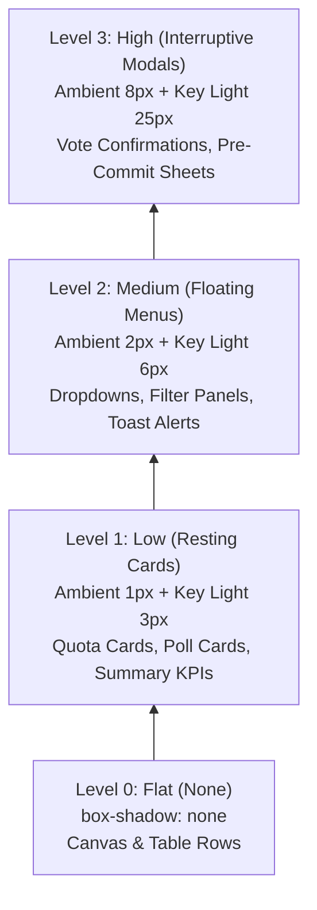

# ACNRPLO — Layout & Elevation System Specification
### Atherstone Collaborative Nature Reserve — Private Land Owners Platform

**Role:** Lead UI Designer  
**Scope:** Multi-Breakpoint Grids & Spatial Elevation Hierarchy  
**Breakpoints:** Mobile (<600px), Tablet (600px–1024px), Desktop (1025px+)  
**Date:** 18 September 2026  

---

## 1. Responsive Grid System

The ACNRPLO grid is structured to ensure dense governance data (land ownership %, voting weights, quota balances) remains completely glanceable on mobile screens in direct sunlight, while expanding gracefully into multi-column executive dashboards on desktop.

| Specification Parameter | Mobile (`< 600px`) | Tablet (`600px – 1024px`) | Desktop (`1025px+`) |
|:---|:---|:---|:---|
| **Column Count** | **4 Columns** | **8 Columns** | **12 Columns** |
| **Gutter Width** | `12px` (`0.75rem`) | `20px` (`1.25rem`) | `24px` (`1.50rem`) |
| **Side Margins** | `16px` (`1.00rem`) | `24px` (`1.50rem`) | `Auto` (Centered, `32px` min padding) |
| **Max Content Width**| Fluid (`100%`) | Fluid (`100%`) | `1280px` (`80rem`) |
| **Primary Navigation**| Fixed Bottom Tab Bar (`64px`) | Adaptive Header or Side Drawer | Persistent Left Sidebar or Sticky Header |
| **Layout Rhythm** | 1-column vertical stack | 2-column grid (`grid-cols-2`) | 3-column / 4-column dashboard |

### 1.1 Responsive Viewport Behaviors

- **Mobile Viewport (`< 600px`)**:
  - **Full-Bleed Edge**: Outer container adheres strictly to `16px` horizontal gutters to maximise screen real estate.
  - **Thumb-Zone Bottom Clearance**: Canvas includes bottom clearance `padding-bottom: calc(64px + env(safe-area-inset-bottom) + 16px)` to prevent content obstruction by the fixed bottom navigation bar.
  - **Single-Column Stacking**: Quota cards, voting topics, and hunt logs render as full-width blocks (`w-full`), ensuring 48px touch targets span the full viewport width.
- **Tablet Viewport (`600px – 1024px`)**:
  - **Two-Column Parity**: Quota cards and active voting polls adapt to a 2-column grid (`grid grid-cols-2 gap-5`).
  - **Calendar & Split Views**: The Shared Reserve Calendar switches from a single-day agenda list to a full 7-day responsive grid.
- **Desktop Viewport (`1025px+`)**:
  - **Optical Boundary (1280px Max)**: Constrains data tables and financial ledgers to an optimal scanning container to prevent horizontal eye fatigue.
  - **Side-by-Side Constitution & AI**: Enables simultaneous side-by-side view with the official Constitution PDF viewer on the left (60% width) and the Cloudflare AI Assistant panel on the right (40% width).

---

## 2. Elevation & Box-Shadow System

The elevation system establishes physical depth in the interface using natural ambient occlusion shadows tinted with our deep charcoal timber neutral (`rgba(21, 27, 23, ...)` in light mode and deep `rgba(0, 0, 0, ...)` in dark mode).



### 2.1 CSS Box-Shadow Tokens

```css
/* ==========================================================================
   Level 0: None / Flat
   ========================================================================== */
--elevation-0: none;

/* ==========================================================================
   Level 1: Low / Card (Resting State)
   ========================================================================== */
/* Light Mode */
--elevation-1: 
  0 1px 3px 0 rgba(21, 27, 23, 0.08),
  0 1px 2px -1px rgba(21, 27, 23, 0.06);

/* Dark Mode */
--elevation-1-dark: 
  0 1px 3px 0 rgba(0, 0, 0, 0.40),
  0 1px 2px -1px rgba(0, 0, 0, 0.30);

/* ==========================================================================
   Level 2: Medium / Floating Overlays
   ========================================================================== */
/* Light Mode */
--elevation-2: 
  0 4px 6px -1px rgba(21, 27, 23, 0.12),
  0 2px 4px -2px rgba(21, 27, 23, 0.08);

/* Dark Mode */
--elevation-2-dark: 
  0 4px 6px -1px rgba(0, 0, 0, 0.50),
  0 2px 4px -2px rgba(0, 0, 0, 0.35);

/* ==========================================================================
   Level 3: High / Modals & Bottom Sheets
   ========================================================================== */
/* Light Mode */
--elevation-3: 
  0 20px 25px -5px rgba(21, 27, 23, 0.20),
  0 8px 10px -6px rgba(21, 27, 23, 0.12);

/* Dark Mode */
--elevation-3-dark: 
  0 20px 25px -5px rgba(0, 0, 0, 0.75),
  0 8px 10px -6px rgba(0, 0, 0, 0.50);
```

---

## 3. Information Hierarchy Application Guide

Elevation directly signals to the user how an element behaves and whether it demands immediate decision focus:

### Level 0: None / Flat (`box-shadow: none`)
- **Semantic Meaning**: Ground-level passive substrate.
- **When to Use**:
  - Main background canvas (`--color-bg-base`).
  - Table rows in the Audit Log and Game Count histories.
  - Inset sub-panels, disabled input fields, and divider rules.
- **Hierarchy Role**: Provides zero optical distraction, letting elevated data layers command attention.

### Level 1: Low / Card (`--elevation-1`)
- **Semantic Meaning**: Tangible, interactive content modules resting directly on the canvas.
- **When to Use**:
  - `GovernanceVoteCard` resting states.
  - `QuotaLedgerCard` and species allocations.
  - Dashboard summary metric widgets (Total Hectares, Active Polls count).
  - Document repository file cards.
- **Hierarchy Role**: Groups related data into distinct visual units while maintaining a calm, orderly page structure.

### Level 2: Medium / Floating Overlays (`--elevation-2`)
- **Semantic Meaning**: Transient or contextual controls detached from the surface.
- **When to Use**:
  - Category filter dropdowns and member selectors.
  - Calendar date-picker popovers.
  - Card hover states (cards elevate from Level 1 to Level 2 on pointer hover).
  - Floating Toast notifications (e.g. *"Hunt logged successfully"*).
- **Hierarchy Role**: Indicates temporary UI elements that require brief user interaction before returning to the main workflow.

### Level 3: High / Interruptive Modals & Sheets (`--elevation-3`)
- **Semantic Meaning**: Critical decision boundaries that interrupt the background experience.
- **When to Use**:
  - **Vote Confirmation Modal**: Where the member reviews their voting weight before final submission.
  - **Quota Trade / Buy Bottom Sheet**: Where monetary or quota transfers are committed.
  - **Secretary User Management Modal**: For creating or deactivating landowner accounts.
  - **Mobile Full-Height AI Assistant Drawer**.
- **Hierarchy Role**: Enforces total user focus. Paired with a darkened backdrop (`backdrop-blur-sm bg-neutral/40`) to make background content inaccessible until the modal is resolved.
